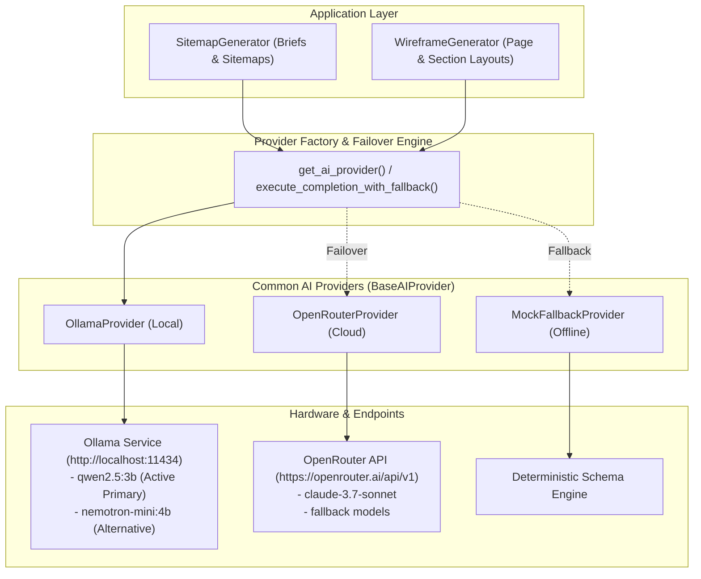

# AI Provider Setup & Local Model Operations Guide
**Project:** Website Design Automation System  
**Document Version:** 1.0.0  
**Phase:** Phase 2 — AI Provider Integration  
**Status:** Approved & Verified  

---

## 1. Executive Summary & Provider Architecture

The Website Design Automation platform features a unified, pluggable **Common AI Provider Subsystem**. This architecture abstracts underlying LLM execution engines behind a standardized `BaseAIProvider` interface, providing:

1. **Vendor Independence**: Zero application code changes required to switch between local models (Ollama, LM Studio) and cloud hosted APIs (OpenRouter, OpenAI).
2. **Deterministic Response Contracts**: All completions normalize token usage, durations, raw payloads, error envelopes, and automated JSON self-healing.
3. **Automated Multi-Tier Failover**: Seamless cascading fallback (`Ollama` $\rightarrow$ `OpenRouter` $\rightarrow$ `Deterministic Mock`) to guarantee that user interactions never crash due to provider timeouts, network blips, or credit limits.
4. **Secret Protection**: Strict isolation of credentials. API keys are masked in error logs and scrubbed from frontend client responses.



---

## 2. Environment Configuration

All provider configurations are controlled centrally via `backend/.env`. A complete template is maintained at `backend/.env.example`.

### Key Environment Variables

| Variable | Type | Default | Description |
| :--- | :--- | :--- | :--- |
| `AI_PROVIDER` | string | `auto` | Active provider selection: `auto`, `ollama`, `openrouter`, or `mock`. |
| `OLLAMA_BASE_URL` | string | `http://localhost:11434` | Base HTTP endpoint for the local Ollama daemon. |
| `OLLAMA_MODEL` | string | `qwen2.5:3b` | Target local model tag installed in Ollama. |
| `OPENROUTER_API_KEY` | string | `""` | OpenRouter API authentication key (`sk-or-v1-...`). |
| `OPENROUTER_MODEL` | string | `anthropic/claude-3.7-sonnet` | Primary cloud model for hosted generation. |
| `OPENROUTER_BASE_URL` | string | `https://openrouter.ai/api/v1` | OpenRouter endpoint URL. |
| `OPENROUTER_FALLBACK_MODELS` | string | comma-separated list | Fallback models attempted in order if primary fails. |
| `AI_TIMEOUT_SECONDS` | int | `45` | Maximum execution time before socket timeout. |
| `AI_MAX_RETRIES` | int | `3` | Maximum retry attempts with exponential backoff on transient errors. |
| `AI_RETRY_DELAY` | float | `1.5` | Base delay (seconds) for exponential backoff. |

---

## 3. Local AI Setup with Ollama

### 3.1 Hardware Compatibility Baseline

Tested and verified on host system hardware:
- **Processor**: AMD Ryzen 7 6800H (8 Cores, 16 Threads)
- **RAM**: 16 GB DDR5
- **Dedicated GPU**: NVIDIA GeForce RTX 3050 Laptop GPU (4 GB VRAM)

### 3.2 Installation & Verification

1. **Verify or Install Ollama**:
   Download and install from [ollama.com](https://ollama.com).
   ```powershell
   ollama --version
   ```
2. **Verify Daemon Connectivity**:
   ```powershell
   curl.exe http://127.0.0.1:11434/
   # Output: Ollama is running
   ```
3. **Pull Recommended Models**:
   ```powershell
   # Primary recommended model (1.9 GB footprint, ~41 tokens/sec on 4GB VRAM):
   ollama pull qwen2.5:3b

   # Alternative compact model (2.7 GB footprint, ~23 tokens/sec):
   ollama pull nemotron-mini:4b
   ```
4. **List Installed Models**:
   ```powershell
   ollama list
   ```

---

## 4. Model Evaluation & Benchmarks

During Phase 2, a standardized empirical evaluation was conducted comparing compatible Ollama models on the host hardware.

### 4.1 Benchmark Evaluation Matrix

| Metric / Dimension | `qwen2.5:3b` (Recommended) | `nemotron-mini:4b` | Evaluation Verdict |
| :--- | :--- | :--- | :--- |
| **Model Size on Disk** | **1.9 GB** | 2.7 GB | Qwen occupies 30% less storage. |
| **VRAM Consumption** | **~2.1 GB** | ~2.9 GB | Both fit in 4GB VRAM; Qwen leaves more system headroom. |
| **JSON Generation Speed** | **40.9 tokens/sec** | 23.1 tokens/sec | **Qwen is 77% faster** in token throughput. |
| **Test 1: Structured JSON Latency** | **4.99 seconds** | 18.28 seconds | **Qwen generated complete sitemap in <5s.** |
| **Test 1: Schema Integrity** | **100% Pass** | 100% Pass | Both generated valid top-level schema keys. |
| **Test 2: Instruction Following** | **100% Pass** (Exact 4 items) | **100% Pass** (Exact 4 items) | Both obeyed negative constraints without markdown. |
| **Test 3: Wireframe Layouts** | **5 Sections** (navbar, hero, features, testimonials, footer) | **5 Sections** (navbar, hero, features, testimonials, footer) | Both produced rich, semantically correct sections. |
| **Test 3: Wireframe Latency** | **5.39 seconds** | 9.89 seconds | **Qwen generated wireframes in nearly half the time.** |

### 4.2 Model Selection Rationale

- **Primary Local Selection**: `qwen2.5:3b` is designated as the default local model for the system (`OLLAMA_MODEL=qwen2.5:3b`). It demonstrates outstanding JSON schema compliance, strict negative constraint obedience, ultra-fast generation (<5s latency), and low VRAM footprint.
- **Secondary Local Alternative**: `nemotron-mini:4b` is supported as an NVIDIA-optimized alternate model.
- **Cloud Hosted Default**: `anthropic/claude-3.7-sonnet` remains the highest-tier hosted model on OpenRouter, with automated fallback to `claude-3.5-sonnet`, `gpt-4.1`, and `deepseek-v3.2`.

---

## 5. Automated Failover & Resilience

All generation flows utilize `execute_completion_with_fallback()`:

```python
from sitemap_app.providers import CompletionRequest, execute_completion_with_fallback

request = CompletionRequest(
    prompt="Generate modern SaaS wireframe",
    system_instruction="Output valid JSON only.",
    response_format={"type": "json_object"}
)

# Executes primary provider -> alternative provider -> mock fallback if needed
response = execute_completion_with_fallback(request)
data = response.parse_as_json()
```

### Self-Healing & Parsing Features:
1. **Markdown Fence Stripping**: Cleans opening and closing ``` tags (` ```json ... ``` `).
2. **Balanced Bracket Recovery**: Recovers nested `{ ... }` or `[ ... ]` substrings if an LLM wraps responses in conversational prose.
3. **Safe Redaction**: Automatically suppresses and redacts any API keys or tokens in HTTP error traces.
4. **Public Endpoint Masking**: The public `/api/config/` endpoint returns `'private_key': None` and reports only boolean availability flags.

---

## 6. Verification & Automated Test Suite

Run the full AI Provider test suites from the project root:

```powershell
# 1. Run all Provider Unit Tests (13 tests)
backend\venv\Scripts\python.exe backend/tests/test_ai_providers.py

# 2. Run API Integration Tests (4 end-to-end tests)
backend\venv\Scripts\python.exe backend/tests/test_api_integration.py

# 3. Run Benchmark Suite
backend\venv\Scripts\python.exe backend/tests/benchmark_models.py qwen2.5:3b nemotron-mini:4b
```

