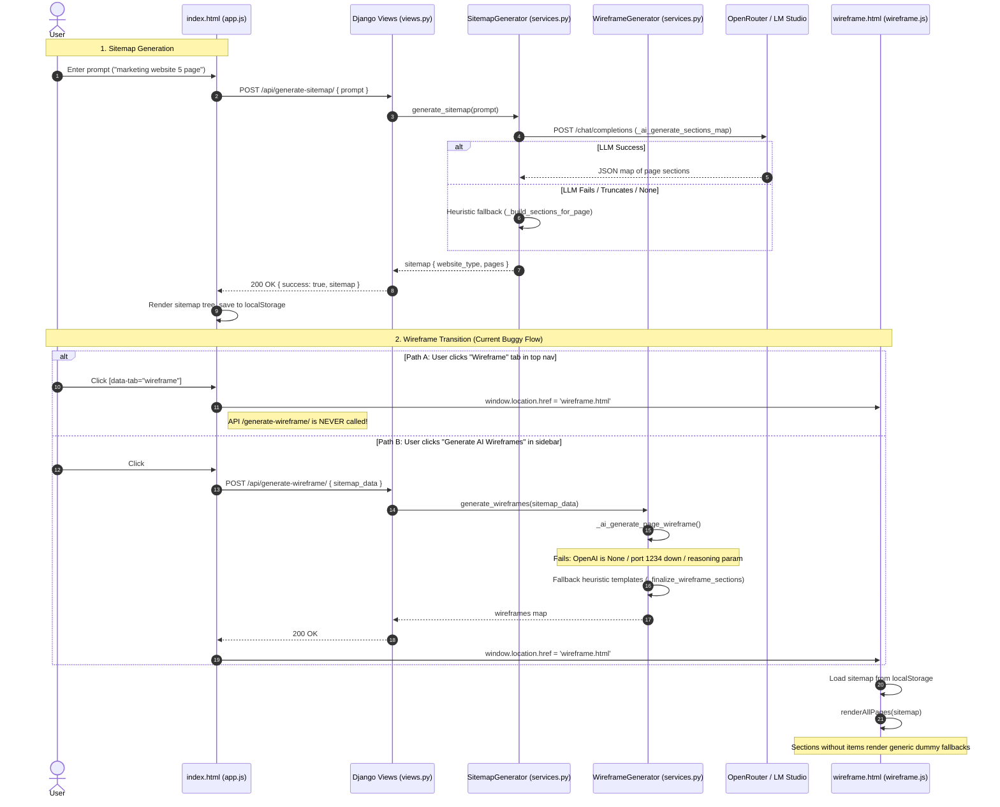

# Codebase Audit & System Investigation Report
**Project:** Website Design Automation System  
**Audit Phase:** Phase 0 — Project Audit & Preparation  
**Date:** November 4, 2026  
**Status:** Complete  

---

## 1. Executive Summary

An exhaustive audit of the **Website Design Automation System** codebase was conducted to investigate why wireframe generation is failing and to establish an actionable baseline for subsequent phases.

The system is designed as a hybrid Django (backend) and Vanilla JavaScript (frontend) web application that translates natural language descriptions into interactive sitemaps and responsive wireframes.

### Key Finding: Primary Failure Chain
The failure of wireframe generation is caused by a multi-layered failure chain:
1. **Missing SDK Dependency (`openai`)**: In `backend/sitemap_app/services.py`, `OpenAI` is imported inside a `try...except ImportError` block that silently falls back to `OpenAI = None`. Because the `openai` Python package was never installed in the virtual environment, `_ai_generate_page_wireframe` aborts immediately (`if not api_key or OpenAI is None: return []`).
2. **Hardcoded Unreachable Local Endpoint**: In `backend/.env`, `WIREFRAME_AI_BASE_URL` is set to `http://localhost:1234/v1/chat/completions` (LM Studio). LM Studio is not running, and the code contains **no fallback** to OpenRouter when the local endpoint is unreachable.
3. **Incompatible Request Parameter**: `WireframeGenerator._ai_generate_page_wireframe` passes `extra_body={"reasoning": {"enabled": True}}`, which causes HTTP 400 Bad Request on standard OpenRouter models and local LLM runtimes that do not support reasoning parameters.
4. **Fragile JSON Parsing & Length Mismatch**: Strip logic relies on `content.startswith('```')`. If the LLM generates any leading explanation, the parser fails with `JSONDecodeError`. Furthermore, if the count of sections generated does not strictly equal `len(normalized_sections)`, the entire AI output is discarded.
5. **Frontend Navigation Disconnect**: Clicking the top-nav "Wireframe" tab navigates directly to `wireframe.html` using the raw sitemap in `localStorage` without invoking the `/api/generate-wireframe/` endpoint, displaying unpopulated placeholder cards. The "Generate AI Wireframes" button in the sidebar is hidden (`display: none`).

---

## 2. Repository Structure

```
wireframe-ai/
├── .gitignore
├── Plan.md                          # Master implementation roadmap (Phases 0-8)
├── backend/
│   ├── .env                         # Environment variables (API keys, models, endpoints)
│   ├── db.sqlite3                   # SQLite database
│   ├── django_error.log             # Server error log
│   ├── manage.py                    # Django management script
│   ├── requirements.txt             # Backend dependencies (Django, DRF, dotenv, openai)
│   ├── core/
│   │   ├── asgi.py
│   │   ├── config.py                # Configuration loader and validator
│   │   ├── settings.py              # Django project settings
│   │   ├── urls.py                  # Root URL dispatcher
│   │   └── wsgi.py
│   ├── sitemap_app/
│   │   ├── admin.py
│   │   ├── api_client.py            # Reference API client
│   │   ├── apps.py
│   │   ├── models.py                # Database models
│   │   ├── serializers.py           # DRF request/response serializers
│   │   ├── services.py              # SitemapGenerator & WireframeGenerator (3600 lines)
│   │   ├── urls.py                  # API routes (/api/*)
│   │   └── views.py                 # API view controllers
│   └── venv/                        # Python virtual environment (incomplete dependencies)
├── frontend/
│   ├── index.html                   # Landing page & Sitemap editor
│   ├── wireframe.html               # Multi-page wireframe canvas & section editor
│   ├── chat.html                    # Interactive AI design briefing chat
│   ├── css/
│   │   ├── chat.css                 # Chat briefing styles
│   │   ├── relume-sidebar.css       # Sidebar & component drawer styles
│   │   ├── style.css                # Base & sitemap canvas styles
│   │   └── wireframe.css            # Wireframe canvas & section styles
│   └── js/
│       ├── app.js                   # Sitemap application controller
│       ├── chat.js                  # Briefing assistant controller
│       ├── state-manager.js         # Pub-Sub StateManager for sitemap synchronization
│       ├── wireframe-editor.js      # Core WireframeEditor (rendering, styles, drag-drop)
│       ├── wireframe-icons.js       # SVG and icon definitions
│       └── wireframe.js             # WireframeApp controller (page export, zip bundling)
└── docs/
    └── CODEBASE_AUDIT.md            # This audit report
```

---

## 3. Existing Architecture Overview

### 3.1 Backend Architecture
The backend is built with **Django 4.2.7** and **Django REST Framework 3.14.0**.

#### API Routes (`backend/sitemap_app/urls.py`):
| Endpoint | Method | Purpose | Input | Output |
|---|---|---|---|---|
| `/api/init-brief/` | `POST` | Generates briefing questions | `{ prompt, ai_enabled }` | `{ success, questions, parsed, ai_error }` |
| `/api/generate-sitemap/` | `POST` | Generates sitemap & sections | `{ prompt, brief_data }` | `{ success, sitemap: { website_type, brief, pages } }` |
| `/api/update-sitemap/` | `POST` | Validates and echoes updated sitemap | `{ sitemap_data }` | `{ success, sitemap }` |
| `/api/export-json/` | `POST` | Exports sitemap as downloadable JSON | `{ sitemap_data }` | Attachment: `sitemap.json` |
| `/api/generate-wireframe/`| `POST` | Generates detailed wireframe layout | `{ sitemap_data }` | `{ success, wireframes: { website_type, brief, wireframes } }` |
| `/api/regenerate-section/`| `POST` | Regenerates single section description | `{ title, type }` | `{ success, description }` |
| `/api/config/` | `GET` | Returns AI models & keys to frontend | None | `{ success, private_key, ai: { chat, wireframe } }` |

#### Core Services (`backend/sitemap_app/services.py`):
- **`SitemapGenerator`** (Lines 16–2689):
  - Natural language parsing and intent detection (`_detect_intent`, `parse_prompt`).
  - Dynamic briefing question generation (`generate_questions_for_brief`, `_ai_suggest_options`).
  - Multi-page section mapping via OpenRouter (`_ai_generate_sections_map`).
  - Heuristic fallback builders (`_build_sections_for_page`, `_normalize_sections`).
- **`WireframeGenerator`** (Lines 2690–3600):
  - AI layout generator using OpenAI client (`_ai_generate_page_wireframe`).
  - Heuristic fallback wireframe generator (`_generate_page_wireframe`).
  - Section finalization and item enricher (`_finalize_wireframe_sections`, `_section_items_from_brief`).

### 3.2 Frontend Architecture
The frontend is composed of Vanilla HTML5/CSS3/ES6 JavaScript without bundlers.

- **`StateManager` (`state-manager.js`)**: An in-memory event-driven state store providing `setSitemap()`, `updatePage()`, `addSection()`, `updateSection()`, `deleteSection()`, and `on(event, callback)`. Synchronizes state to `localStorage.getItem('currentSitemap')`.
- **`WireframeEditor` (`wireframe-editor.js`)**: A large 5,000-line controller handling:
  - Multi-column canvas rendering (`renderAllPages()`, `createPageColumn()`).
  - Section rendering routing (`createSectionContent()` -> hero, navbar, features, travel, or generic).
  - Inline editing (`handleInlineEdit()`), style manipulation, color/font palettes, and responsive breakpoints (Desktop, Tablet, Mobile).
  - Client-side AI layout variant generation (`generateLayoutOptions()`).
- **`WireframeApp` (`wireframe.js`)**: Handles wireframe page boot, page selection for export, DOM scraping (`scrapePageFromDOM()`), and multi-format export engines (HTML/CSS, WordPress Elementor JSON, Webflow JSON, React + Tailwind ZIP via JSZip).

---

## 4. AI Integration & OpenRouter Configuration Audit

### 4.1 Inconsistent Calling Mechanisms
The backend uses two completely different communication mechanisms for AI calls:
1. **Raw `urllib.request`**: Used in `SitemapGenerator` (`_ai_suggest_options`, `_ai_extract_brief`, `_ai_generate_sections_map`).
   - Does not require third-party libraries.
   - Manages fallback model arrays (`primary_model` + `fallback_models`).
   - Suffers from low timeouts (5s to 20s) and a very low `max_tokens: 700` limit.
2. **`OpenAI` Python SDK**: Used exclusively in `WireframeGenerator._ai_generate_page_wireframe`.
   - Requires `from openai import OpenAI`.
   - If `openai` is uninstalled, it silently fails because `OpenAI = None`.
   - Does NOT use fallback models.
   - Does NOT handle local provider disconnections gracefully.

### 4.2 Configuration Parameters (`backend/core/config.py` & `backend/.env`)
```ini
PRIVATE_KEY=sk-or-v1-...
AI_API_KEY=sk-or-v1-...
AI_BASE_URL=https://openrouter.ai/api/v1/chat/completions
AI_MODEL=anthropic/claude-3.7-sonnet

CHAT_AI_ENABLED=true
CHAT_AI_MODEL=anthropic/claude-3.7-sonnet
CHAT_AI_BASE_URL=https://openrouter.ai/api/v1/chat/completions
CHAT_AI_FALLBACK_MODELS=anthropic/claude-3.5-sonnet,openai/gpt-4.1,deepseek/deepseek-v3.2

WIREFRAME_AI_MODEL=qwen2.5-7b-instruct-1m
WIREFRAME_AI_BASE_URL=http://localhost:1234/v1/chat/completions
```

#### Observations:
- `WIREFRAME_AI_BASE_URL` points to `http://localhost:1234/v1/chat/completions` (LM Studio), but LM Studio is not running in the development environment.
- When `WireframeGenerator` initializes the OpenAI client:
  ```python
  normalized_base_url = base_url.rstrip('/')
  if normalized_base_url.endswith('/chat/completions'):
      normalized_base_url = normalized_base_url[:-len('/chat/completions')]
  ```
  It attempts to connect to `http://localhost:1234/v1` and fails with `ConnectionRefusedError`.
- There is **no fallback** to `CHAT_AI_BASE_URL` or `CHAT_AI_MODEL` when `wireframe_ai_base_url` fails.

---

## 5. Sitemap & Wireframe Generation Workflows



---

## 6. Detailed Root Cause Analysis

### 6.1 Root Cause #1: Missing `openai` Package in Environment
- **File:** `backend/sitemap_app/services.py`, lines 10–13, line 3169
- **Evidence:**
  ```python
  try:
      from openai import OpenAI
  except ImportError:
      OpenAI = None
  ...
  if not api_key or OpenAI is None:
      return []
  ```
- **Impact:** Since `openai` was never installed into the active environment, `OpenAI` evaluates to `None`. The AI wireframe generator immediately exits on line 3170 without executing any network calls.

### 6.2 Root Cause #2: Dead-End Local Endpoint with No Fallback
- **File:** `backend/.env`, line 14; `backend/sitemap_app/services.py`, lines 3172–3175, lines 3299–3304
- **Evidence:**
  ```python
  base_url = config.wireframe_ai_base_url or config.chat_ai_base_url
  model = config.wireframe_ai_model or config.chat_ai_model
  ```
- **Impact:** `config.wireframe_ai_base_url` is non-empty (`http://localhost:1234/v1/chat/completions`). Even if `openai` is installed, it targets port 1234. If LM Studio is not running, it catches `ConnectionRefusedError`, logs `Local wireframe model failed`, and returns `[]`. It never attempts `config.chat_ai_base_url`.

### 6.3 Root Cause #3: Unsupported Parameter `extra_body={"reasoning": {"enabled": True}}`
- **File:** `backend/sitemap_app/services.py`, line 3266
- **Evidence:**
  ```python
  response = client.chat.completions.create(
      model=model,
      messages=[...],
      temperature=0.3,
      max_tokens=1500,
      extra_body={"reasoning": {"enabled": True}}
  )
  ```
- **Impact:** When routed to models or providers that do not implement Anthropic-style reasoning extensions via OpenAI SDK (e.g., standard LM Studio or open-source Qwen models), the provider returns HTTP 400 (`Unrecognized request argument: reasoning`), causing the call to fail.

### 6.4 Root Cause #4: Inflexible Output Validation (`len(cleaned) == len(normalized_sections)`)
- **File:** `backend/sitemap_app/services.py`, line 3297
- **Evidence:**
  ```python
  if cleaned and len(cleaned) == len(normalized_sections):
      return self._finalize_wireframe_sections(cleaned, page_context, sitemap_data)
  ```
- **Impact:** If the LLM generates 4 sections instead of 5, or 6 instead of 5, the entire generation is rejected and discarded.

### 6.5 Root Cause #5: Fragile Markdown Code Fence Stripping
- **File:** `backend/sitemap_app/services.py`, lines 3271–3275
- **Evidence:**
  ```python
  if content.startswith('```'):
      content = content.replace('```json', '', 1)
      content = content.replace('```', '')
  content = content.strip()
  parsed_json = json.loads(content)
  ```
- **Impact:** If the LLM produces introductory text like `Here is your JSON layout: \n```json...`, `content.startswith('```')` is false. The fences remain and `json.loads` throws `json.decoder.JSONDecodeError`.

### 6.6 Root Cause #6: Token Truncation in Section Generation
- **File:** `backend/sitemap_app/services.py`, line 855
- **Evidence:**
  ```python
  'max_tokens': 700
  ```
- **Impact:** Asking the model to generate sections for all pages in a sitemap (often 5 to 10 pages, each with 5 sections) requires 1,200–2,000 tokens. A 700 token ceiling truncates the JSON string midway through, causing `json.loads()` to crash with `JSONDecodeError: Unterminated string`.

### 6.7 Root Cause #7: Security Risk & Direct Browser API Calls in Frontend
- **File:** `backend/sitemap_app/views.py`, line 130; `frontend/js/wireframe-editor.js`, lines 3680–3745
- **Evidence:**
  `views.py`:
  ```python
  return Response({
      'success': True,
      'private_key': config.private_key,  # EXPOSES SERVER SECRET KEY TO BROWSER
      ...
  })
  ```
  `wireframe-editor.js`:
  ```javascript
  async getPrivateKey() {
      const response = await fetch('/api/config/');
      const data = await response.json();
      return data.private_key;
      return null; // Dead code
  }
  ...
  const response = await fetch(baseUrl, {
      method: 'POST',
      headers: { 'Authorization': `Bearer ${apiKey}`, ... },
      body: JSON.stringify({ model, messages: ... })
  });
  ```
- **Impact:** Server private keys are leaked to the client browser. Browser calls directly to `http://localhost:1234` or third-party APIs get blocked by browser CORS restrictions or network firewalls. Dead code `return null;` exists immediately after `return data.private_key;`.

### 6.8 Root Cause #8: Hardcoded Domain Coupling (`isTravelSection`)
- **File:** `frontend/js/wireframe-editor.js`, lines 1602–1612
- **Evidence:**
  ```javascript
  isTravelSection(type, title) {
      const travelTypes = [
          'search-form', 'filters', 'promo', 'results', 'sorting',
          'fare-details', 'seat-selection', 'passenger-form', 'special-requests',
          'addons', 'pricing', 'order-summary', 'gst', 'payment', 'terms', 'policies',
          'offers', 'trust', 'trip-types', 'auth', 'stats', 'management', 'support', 'summary'
      ];
      if (travelTypes.includes(type)) return true;
      const t = title || '';
      return /flight|booking|fare|seat|passenger|checkout|gst|payment|offer|pnr|trip/i.test(t);
  }
  ```
- **Impact:** If an e-commerce, SaaS, or agency sitemap contains sections with standard types like `pricing`, `stats`, `support`, `offers`, or `summary`, they are wrongly categorized as travel sections and rendered with flight booking UI (flight search cards, departure dates, seat selection).

### 6.9 Root Cause #9: StateManager Hierarchical Tree Incompatibility
- **File:** `frontend/js/state-manager.js`, lines 49–94
- **Evidence:**
  ```javascript
  findPageById(pageId) {
      if (!this.sitemap || !this.sitemap.pages) return null;
      return this.sitemap.pages.find(p => p.id === pageId);
  }
  ```
- **Impact:** Only top-level pages in `sitemap.pages` can be found or edited. Child pages in `page.children` are inaccessible, causing section addition, editing, and deletion to silently fail for sub-pages.

### 6.10 Root Cause #10: Unhandled Logging Permission Failure
- **File:** `backend/core/settings.py`, lines 122–126
- **Evidence:**
  ```python
  'handlers': {
      'file': {
          'level': 'ERROR',
          'class': 'logging.FileHandler',
          'filename': BASE_DIR / 'django_error.log',
      },
  }
  ```
- **Impact:** When the repository is cloned or run in sandboxed or read-only environments, attempting to open `django_error.log` raises `PermissionError: [Errno 13] Permission denied`, preventing Django from starting.

---

## 7. Component & Schema Mismatches

### 7.1 Section Types: Backend vs. Frontend Support Matrix
| Section Type | Generated by Backend? | Frontend Dedicated Renderer? | Behavior in Frontend |
|---|---|---|---|
| `navbar` | Yes | Yes (`createNavbarContent`) | Renders navigation bar |
| `hero` | Yes | Yes (`createHeroContent`) | Renders hero layout |
| `features` / `key-features` | Yes | Yes (`createFeaturesContent`) | Renders features grid |
| `services` | Yes | Yes (`createServicesWireframe`) | Renders service cards |
| `testimonial` | Yes | Yes (`createTestimonialWireframe`) | Renders testimonial cards |
| `pricing` | Yes | Buggy (`isTravelSection` intercepts) | Renders flight booking card instead of pricing table! |
| `stats` | Yes | Buggy (`isTravelSection` intercepts) | Renders flight stats card! |
| `faq` | Yes | **NO** | Falls to `generateIntelligentWireframe` (no accordion) |
| `gallery` | Yes | Yes (`createGalleryWireframe`) | Renders image gallery |
| `blog` | Yes | Yes (`createBlogWireframe`) | Renders blog posts |
| `contact` / `contact-form` | Yes | Yes (`createContactFormWireframe`) | Renders contact form |
| `contact-details` | Yes | Yes (`createContactDetailsWireframe`) | Renders contact info list |
| `team` | Yes | Yes (`createTeamWireframe`) | Renders team member cards |
| `story` / `about` | Yes | Yes (`createStoryWireframe`) | Renders company story |
| `culture` / `values` | Yes | Yes (`createCultureWireframe`) | Renders culture cards |
| `location` / `map` | Yes | Yes (`createLocationWireframe`) | Renders map placeholder |
| `main-info` / `supporting-info` | Yes | Yes | Renders generic text columns |
| `footer` | Yes | Yes (`createFooterWireframe`) | Renders site footer |
| `highlights` | Yes | **NO** | Generic fallback |
| `benefits` | Yes | **NO** | Generic fallback |
| `legal` / `policies` | Yes | Buggy (`isTravelSection` intercepts) | Renders flight terms |

### 7.2 Section Data Schema Mismatch
- **Backend Schema Expected by Frontend**:
  ```typescript
  interface WireframeSection {
    id: string;
    type: string;
    title: string;
    description: string;
    layoutVariant?: string;
    buttonText?: string;
    menuItems?: string[];
    items?: Array<{
      title: string;
      desc?: string;
      icon?: string;
      role?: string;
      price?: string;
      tag?: string;
      label?: string;
      value?: string;
      features?: string[];
    }>;
  }
  ```
- **What Backend `generate_sitemap` Returns**:
  Only `{ id, type, title, description }`. It does **not** populate `items`, `buttonText`, or `menuItems`.
- **Consequence**: When navigating to `wireframe.html` without running `generate-wireframe`, `section.items` is undefined, forcing `WireframeEditor` to render hardcoded fallback cards (`Strategy`, `Innovation`, `Growth`).

---

## 8. Prioritized Bug List

| ID | Priority | Category | Description | File & Line |
|---|---|---|---|---|
| **BUG-01** | **P0** | AI / Backend | Missing `openai` package causes `OpenAI = None`, completely disabling AI wireframe generation. | `backend/sitemap_app/services.py:10-13, 3169` |
| **BUG-02** | **P0** | AI / Backend | Local model failure (`localhost:1234`) lacks fallback to OpenRouter, causing total failure when LM Studio is down. | `backend/sitemap_app/services.py:3172-3175, 3299-3304` |
| **BUG-03** | **P0** | AI / Backend | Incompatible `extra_body={"reasoning": {"enabled": True}}` causes HTTP 400 on standard LLMs. | `backend/sitemap_app/services.py:3266` |
| **BUG-04** | **P0** | Frontend / UX | Top navigation "Wireframe" tab navigates directly to `wireframe.html` without invoking `/api/generate-wireframe/`. | `frontend/js/app.js:223-234` |
| **BUG-05** | **P0** | Security / Arch | `get_config` exposes `private_key` to client; frontend makes direct external API calls. | `backend/sitemap_app/views.py:130`, `frontend/js/wireframe-editor.js:3680-3745` |
| **BUG-06** | **P1** | Backend / Parsing | JSON code fence stripping fails if leading text exists; strict length check discards valid AI layouts. | `backend/sitemap_app/services.py:3271-3275, 3297` |
| **BUG-07** | **P1** | Backend / AI | Max tokens is capped at 700 for multi-page section generation, leading to truncated JSON. | `backend/sitemap_app/services.py:855` |
| **BUG-08** | **P1** | Frontend / Logic | `isTravelSection` intercepts generic section types (`pricing`, `stats`, `offers`) and renders flight UI on non-travel websites. | `frontend/js/wireframe-editor.js:1602-1612` |
| **BUG-09** | **P1** | Frontend / State | `StateManager` cannot find or update nested child pages in `page.children`. | `frontend/js/state-manager.js:49-94` |
| **BUG-10** | **P2** | Frontend / Rendering | Missing dedicated renderers for `faq`, `highlights`, `benefits`, and `legal` sections. | `frontend/js/wireframe-editor.js:2357-2410` |
| **BUG-11** | **P2** | Backend / System | Hardcoded file logger fails with `PermissionError` when write access is restricted. | `backend/core/settings.py:122-126` |
| **BUG-12** | **P2** | Frontend / UI | Dead code in `wireframe-editor.js` (`return null;` after `return data.private_key;`). | `frontend/js/wireframe-editor.js:3743-3744` |

---

## 9. Implementation Strategy & Roadmap Alignment

To systematically resolve these issues without regressions, the roadmap outlined in `Plan.md` should be executed across the following phases:

### Phase 1 — Architecture & Technical Foundation
- Standardize the wireframe JSON schema with comprehensive specifications for all section types and item structures (`docs/WIREFRAME_SCHEMA.md`).
- Define the backend-frontend contract (`docs/ARCHITECTURE.md`) ensuring all AI calls remain securely on the backend.
- Refactor `StateManager` to support recursive tree traversal for nested pages.

### Phase 2 — AI Provider Integration
- Create a unified `AIProvider` abstraction (supporting OpenRouter, Ollama, and local OpenAI-compatible servers like LM Studio).
- Implement automatic failover: if local provider (`localhost:1234`) is unreachable or times out, seamlessly fall back to OpenRouter.
- Eliminate client-side API calls: introduce backend proxy endpoint `/api/generate-layout-options/` and redact `private_key` from `/api/config/`.
- Remove incompatible `extra_body` reasoning flags and implement robust JSON extraction with regex-based code block extraction.

### Phase 3 — Sitemap Generation Workflow
- Increase max tokens for multi-page section generation.
- Ensure all pages and sections are created with consistent unique IDs and semantic types.

### Phase 4 — Wireframe Generation Engine
- Enhance `WireframeGenerator` to populate rich section metadata (`items`, `buttonText`, `layoutVariant`, `menuItems`) for all standard section types.
- Ensure sitemap sections are smoothly enriched rather than discarded.

### Phase 5 — Frontend Wireframe Renderer
- Decouple `isTravelSection` so it only activates when `sitemap.website_type` is genuinely a travel/flight website.
- Add dedicated renderers for `faq` (collapsible accordion), `stats`, `pricing`, `benefits`, and `legal`.
- Unify navigation: ensure switching to the Wireframe tab automatically requests wireframe enrichment if not already generated.

### Phase 6 & 7 — Interactive Editing, Export, Testing & Polish
- Ensure live DOM changes sync bi-directionally to state and exports (WordPress, Webflow, React+Tailwind, HTML/CSS).
- End-to-end integration tests and validation.

---

## 10. Phase 0 Completion Verification

All Phase 0 requirements and completion criteria have been satisfied:
- [x] Complete repository structure inspected.
- [x] Frontend architecture and controllers analyzed.
- [x] Backend architecture, services, and endpoints audited.
- [x] AI integration, OpenRouter config, and prompt workflows examined.
- [x] Root causes of generation failure isolated with exact file and line references.
- [x] Missing components, schema mismatches, and security risks identified.
- [x] `docs/CODEBASE_AUDIT.md` delivered.
- [x] Prioritized bug list and implementation strategy formulated.
- [x] Zero premature or destabilizing code modifications made.

