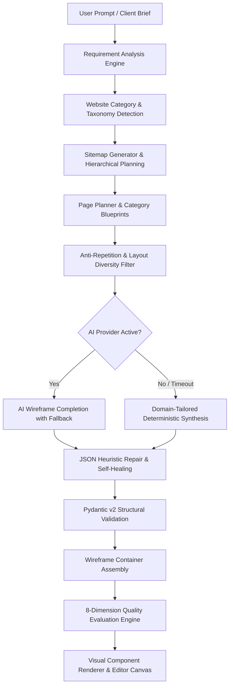

# Generation Pipeline & Quality Optimization Architecture
**Website Design Automation System — Phase 7 Specification**

---

## 1. Pipeline Overview

The Generation Pipeline is an end-to-end, multi-stage engine that transforms unstructured user prompts or structured client briefs into verified, production-grade, multi-page wireframes.



---

## 2. Supported Website Categories (10 Canonical Taxonomies)

The generation pipeline provides first-class support for 10 distinct website categories. Each category features dedicated industry heuristics, custom taxonomies, targeted conversion goals, bespoke navigation trees, and tailored copywriting palettes:

| # | Category | Core Industry Focus | Primary CTA | Primary Nav | Signature Components |
|---|----------|---------------------|-------------|-------------|----------------------|
| 1 | `business` | Corporate Enterprise & Consulting | Request Consultation | About, Services, Case Studies, Insights, Contact | Enterprise Solutions, Transformation Methodology, Fortune 500 Stats, Partner Reviews |
| 2 | `saas` | Cloud Platforms & Workflow Apps | Start Free Trial | Features, Solutions, Pricing, Docs, Contact | Feature Matrix, Interactive API Docs, Tiered Pricing Matrix, SOC2 Compliance Badges |
| 3 | `ecommerce` | Online Retail & Marketplaces | Shop New Arrivals | Shop, Categories, Best Sellers, Deals, Support | Product Grid, Limited Time Promos, Shopping Guarantees (Carbon-neutral delivery, 30-day returns) |
| 4 | `portfolio` | Designers, Artists & Developers | Hire Me | Work, Case Studies, Philosophy, Contact | High-Res Visual Gallery, Case Study Deep Dives, Toolset Badges, Direct Inquiries |
| 5 | `agency` | Creative Studios & Marketing | Work With Us | Work, Services, Sprint Process, About, Contact | Showreel, 4-Step Sprint Methodology, Client Funding Stats, Executive Endorsements |
| 6 | `healthcare` | Hospitals, Clinics & Telehealth | Book Appointment | Specialties, Physicians, Patient Portal, Emergency | Clinical Specialties, Board-Certified Doctor Profiles, 24/7 Hotline, Patient FAQs |
| 7 | `education` | Universities, Academies & Schools | Apply for Admission | Programs, Admissions, Faculty, Campus, Contact | Degree Catalog, Research Grants & Outcomes, Faculty Credentials, Application Portals |
| 8 | `agriculture` | Farms, AgTech & Organic Produce | Inquire Wholesale | Produce, Practices, Sustainability, Wholesale, Contact | Seasonal Crop Calendars, Regenerative Farming Process, Non-GMO Certifications, Wholesale Inquiry |
| 9 | `blog` | Editorial Magazines & Publications | Subscribe Free | Trending, Categories, Authors, Masthead, Contact | Lead Editorial Story, Curated Briefing, Chronological Feed with Read Times, Contributor Bios |
| 10 | `restaurant` | Dining, Cafes & Culinary Venues | Reserve a Table | Menu, Reservations, Kitchen Story, Private Events | Signature Seasonal Menu, Kitchen Heritage Story, Dining Ambiance Gallery, Table Booking Widget |

---

## 3. Section Selection & Category-Specific Page Blueprints

Rather than imposing identical generic sections across different industries, `PagePlanner` resolves blueprints using a hierarchical taxonomy lookup:
1. `(website_category, page_category)` — Industry-bespoke sequence (e.g. `('healthcare', 'home')` or `('agriculture', 'home')`).
2. `(website_category, 'home')` — Category-specific home page blueprint if evaluating the root landing page.
3. `CANONICAL_PAGE_BLUEPRINTS[page_category]` — Standard canonical blueprint for sub-pages (e.g. `about`, `pricing`, `contact`).
4. `CANONICAL_PAGE_BLUEPRINTS['generic']` — Fallback blueprint.

### Sample Category Blueprints

#### Agriculture (`agriculture`, `home`)
1. **Navbar** (`layout-default`): Farm brand identity, navigation links, and `"Wholesale Inquiry"` action.
2. **Hero** (`layout-split-right`): *"Sustainable Agriculture & Certified Crop Harvests"* — Farm-to-table supply reliability and regenerative farming.
3. **Features** (`layout-grid-3`): *"Seasonal Produce & Farm Capabilities"* — Certified organic fruits, vegetables, grains, and agronomy solutions.
4. **Process** (`layout-cards`): *"Regenerative Farming & Supply Chain"* — Soil remediation, sensor-driven irrigation, and cold-chain distribution.
5. **Stats** (`layout-grid-4`): *"Harvest Scale & Environmental Metrics"* — 50,000+ Acres, 100% Non-GMO, 12,000 Metric Tons, 48hr delivery.
6. **Gallery** (`layout-grid-3`): *"Farm Fields & Operational Facilities"* — Hydroponic greenhouses, heirloom orchards, and packing hubs.
7. **Testimonial** (`layout-cards`): *"Commercial Partner Endorsements"* — Supermarket chain procurement directors and distributors.
8. **CTA** (`layout-centered`): *"Partner With Our Harvest Operations"* — Wholesale contracts and seasonal supply inquiries.
9. **Footer** (`layout-multi-column`): Certifications, farming locations, and distributor resources.

#### Healthcare (`healthcare`, `home`)
1. **Navbar** (`layout-default`): Medical clinic branding and `"Book Appointment"` action.
2. **Hero** (`layout-split-right`): *"Advanced Medical Care & Compassionate Support"* — Board-certified specialists and patient care.
3. **Services** (`layout-cards`): *"Clinical Specialties & Departments"* — Cardiology, neurology, pediatrics, and emergency trauma.
4. **Features** (`layout-grid-3`): *"Why Patients Trust Us"* — 24/7 emergency response, accredited diagnostic labs, and digital health records.
5. **Team** (`layout-grid-3`): *"Our Leading Physicians & Specialists"* — Board-certified surgeons and clinicians with university credentials.
6. **Stats** (`layout-grid-4`): *"Clinical Excellence Metrics"* — 50,000+ Patients Treated, 99.2% Clinical Satisfaction, 120+ Specialists, 24/7 ER.
7. **Contact Form** (`layout-split-left`): *"Schedule Your Consultation Today"* — Frictionless appointment scheduling form.
8. **FAQ** (`layout-list`): *"Patient FAQs & Insurance Info"* — Accepted insurance providers, visit preparation, and medical records.
9. **Footer** (`layout-multi-column`): Emergency hotline, hospital campus map, and patient rights.

---

## 4. Layout Diversity & Anti-Repetition Engine

Monotonous wireframes with identical consecutive layouts undermine user engagement and visual hierarchy. The pipeline enforces strict anti-repetition rules:

### Rules Enforced by `PagePlanner.enforce_layout_diversity()`:
1. **Adjacent Layout Alternation**: No two consecutive sections may share the same `layoutVariant`.
   - If a consecutive repetition is detected (e.g. `layout-grid-3` followed by `layout-grid-3`), the engine automatically alternates the second section to a complementary layout (e.g. `layout-cards`, `layout-split`, or `layout-list`).
2. **Duplicate Section Prevention**: Consecutive duplicate section types (e.g. two `features` or two `cta` blocks in a row) are automatically transformed into complementary section types (e.g. `process`, `stats`, or `main-info`).
3. **Mandatory Structural Framing**:
   - `navbar` is always at index 0 (order weight 0).
   - `hero` is always placed at index 1 on primary landing pages.
   - `footer` is always anchored at the bottom (order weight 100).
4. **Responsive Grid Sizing**:
   - `layout-grid-3`: Enforces 3 or 6 items to prevent awkward single orphan columns on collapse.
   - `layout-grid-4`: Enforces 4 items.
   - `layout-grid-2`: Enforces 2 or 4 items.

---

## 5. Spacing, Hierarchy & Design System Tokens

Visual hierarchy is maintained via CSS design tokens and semantic section classes:

### Section Spacing Tokens
- **Hero Sections** (`.wireframe-section.hero`, `.wf-spacing-hero`):
  - Desktop: `88px 32px`
  - Tablet: `56px 24px`
  - Mobile: `40px 16px`
- **Standard Content Sections** (`.wireframe-section`):
  - Desktop: `72px 32px`
  - Tablet: `48px 24px`
  - Mobile: `32px 16px`
- **CTA Banners** (`.wireframe-section.cta`, `.wf-spacing-cta`):
  - Desktop: `64px 32px`
  - Tablet: `44px 24px`
  - Mobile: `28px 16px`
- **Navbar** (`.wireframe-section.navbar`):
  - Desktop: `16px 32px`
  - Tablet: `14px 24px`
  - Mobile: `12px 16px`
- **Footer** (`.wireframe-section.footer`):
  - Desktop: `64px 32px 32px`
  - Tablet: `48px 24px 24px`
  - Mobile: `36px 16px 20px`

### Image Placeholder Highlights
Placeholder boxes use SVG watermarks colored according to industry conventions:
- Healthcare: Blue (`#0284c7`)
- Agriculture: Green (`#16a34a`)
- Restaurant: Warm Amber (`#ea580c`)
- Education: Purple (`#7c3aed`)
- E-Commerce: Royal Blue (`#2563eb`)
- SaaS: Indigo (`#6366f1`)

---

## 6. Prompt Engineering Architecture

The prompt engineering architecture guarantees that whether generation is powered by an active LLM or running via deterministic fallback, the resulting copy is authentic, specific, and professional.

### System Prompt
```text
You are an elite website UX/UI architect and conversion copywriting specialist.
Generate production-grade wireframe sections tailored specifically to the given industry category and client brief.
Strictly avoid placeholder copy such as 'Lorem ipsum', 'Feature 1', 'Item 1', 'Title here'.
Every headline and body copy must be realistic, compelling, domain-specific, and conversion-focused.
Ensure adjacent sections feature diverse, alternating layout variants (e.g. split -> grid -> cards -> centered).
Return only a valid JSON array of section objects. Do not include markdown fences,
explanations, or conversational prose.
```

### Deterministic Fallback Synthesis
When the LLM is offline or times out, the service does not emit placeholder text. It employs `_get_category_specific_items()`, injecting pre-validated, industry-grade items across all 10 categories:
- Authentic statistics with metrics (e.g. `"50,000+ Acres Cultivated"`, `"99.99% Guaranteed SLA"`).
- Verified customer roles and company affiliations.
- Domain-appropriate Lucide icon references.
- Real-world pricing tiers and features.

---

## 7. Quality Evaluation Framework

The Quality Evaluation Engine (`QualityEvaluator`) rigorously audits generated wireframes across 8 canonical dimensions:

$$\text{Overall Score} = \sum_{i=1}^{8} (\text{Dimension Score}_i \times \text{Weight}_i)$$

| Dimension | Weight | Audit Criteria |
|-----------|--------|----------------|
| `requirement_coverage` | 15% | All sitemap pages generated; key client brief requirements (services, goals, features) reflected in copy. |
| `sitemap_quality` | 10% | Zero duplicate page IDs; proper page naming; clear structural hierarchy without circular references. |
| `layout_quality` | 15% | Zero adjacent layout duplicates; valid canonical `layoutVariant` values; minimum 3 unique layouts per page. |
| `content_relevance` | 15% | 100% absence of generic copy (`Lorem ipsum`, `Feature 1`, `Sample text`); verified presence of domain terminology. |
| `component_consistency` | 15% | All section types belong to 32 supported components; mandatory Navbar at top and Footer at bottom; CTA on landing pages. |
| `responsive_correctness` | 10% | Balanced item counts for grid collapse (3/6 for grid-3, 4 for grid-4); navbar link count $\le 7$. |
| `json_validity` | 10% | Schema passes Pydantic v2 `validate_wireframe()` without type or constraint violations. |
| `rendering_success` | 10% | All required rendering fields (`id`, `type`, `title`, `description`, `layoutVariant`, `buttonText`, `items`) present. |

### Grading Scale
- **A+ (95.0 – 100.0)**: Exemplary generation with rich domain copy and optimal visual rhythm.
- **A (90.0 – 94.9)**: Production-ready; full requirement coverage and schema validity.
- **B (80.0 – 89.9)**: Good quality; minor layout repetition or short copy.
- **C (70.0 – 79.9)**: Acceptable; needs layout diversification or copy enrichment.
- **F (< 70.0)**: Incomplete or schema non-compliant output requiring regeneration.

---

## 8. API Endpoints

### 1. Generate Wireframes
- **Endpoint**: `POST /api/generate-wireframe/`
- **Payload**:
  ```json
  {
    "sitemap_data": {
      "website_type": "Agriculture & Farming Website",
      "brief": {
        "client": "GreenMeadows Organics",
        "type": "agriculture"
      },
      "pages": [{ "id": "home", "name": "Home" }]
    },
    "page_id": "home"
  }
  ```
- **Response**: Full wireframe container with category-adapted sections.

### 2. Quality Evaluation
- **Endpoint**: `POST /api/evaluate-quality/`
- **Payload**:
  ```json
  {
    "wireframe_data": { ... },
    "sitemap_data": { ... }
  }
  ```
- **Response**:
  ```json
  {
    "success": true,
    "report": {
      "overall_score": 97.5,
      "grade": "A+",
      "dimension_scores": {
        "requirement_coverage": 100.0,
        "sitemap_quality": 100.0,
        "layout_quality": 95.0,
        "content_relevance": 100.0,
        "component_consistency": 100.0,
        "responsive_correctness": 100.0,
        "json_validity": 100.0,
        "rendering_success": 100.0
      },
      "issues": [],
      "recommendations": ["Generation quality meets highest standard. Ready for export and client review."],
      "metadata": {
        "website_category": "agriculture",
        "pages_evaluated": 1,
        "total_sections": 9
      }
    }
  }
  ```

