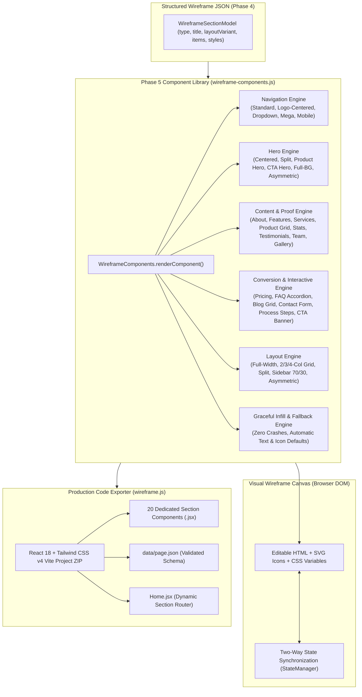

# Wireframe Component Library & Renderer Specification
**Project:** Website Design Automation System  
**Document Version:** 1.0.0  
**Phase:** Phase 5 — Wireframe Component Library & Renderer  
**Status:** Approved & Implemented  
**Date:** November 4, 2026  

---

## 1. Executive Summary & Purpose

The **Wireframe Component Library & Renderer** is the visual rendering and code generation engine of the Website Design Automation System. It transforms structured JSON wireframe definitions (validated via Pydantic in Phase 4) into interactive, high-fidelity visual wireframes on the browser canvas and clean production code (React + Tailwind CSS v4, Elementor JSON, Webflow JSON).

Phase 5 addresses previous visual rendering limitations:
- **Canonical Coverage**: Complete support for all 32 canonical section types across 10 industry categories.
- **Visual Distinction**: Eliminates generic placeholder boxes in favor of structurally meaningful visual wireframes with clear semantic cues (product pricing badges, star ratings, expandable FAQ accordions, multi-column mega menus, step-by-step process milestones, and mobile navigation drawers).
- **Two-Way Inline Sync**: Every editable heading, paragraph, card item, and label carries `.editable-text` markers and `data-field` attributes that bind directly to `StateManager` for instantaneous updates.
- **Strict Layout Engine**: Comprehensive implementation of all 8 layout variants (Full-width, 2-Column, 3-Column, 4-Column Grid, Split 50/50, Sidebar 70/30, Centered Stack, and Asymmetric).
- **Universal JSON-to-React Export**: Dedicated JSX component templates (`Navbar.jsx`, `HeroSection.jsx`, `AboutSection.jsx`, `ImageTextSection.jsx`, `FeaturesGrid.jsx`, `ServicesGrid.jsx`, `ProductGrid.jsx`, `StatsSection.jsx`, `Testimonials.jsx`, `TeamSection.jsx`, `GallerySection.jsx`, `PricingSection.jsx`, `FAQSection.jsx`, `BlogSection.jsx`, `ContactSection.jsx`, `ProcessSection.jsx`, `SidebarSection.jsx`, `CTASection.jsx`, `Footer.jsx`, `Section.jsx`) bundled into a self-contained Vite + Tailwind CSS v4 project ZIP.

---

## 2. Component Catalog & Architecture



---

## 3. Navigation Components

| Component | Layout Variant | Visual Anatomy & Behavior |
| :--- | :--- | :--- |
| **Standard Navbar** | `layout-horizontal` | Brand logo on left, horizontal nav links, primary action CTA button. |
| **Logo-Centered Navbar** | `layout-centered-logo` | Symmetrical split navigation: left links, centered brand logo, right links with login/signup buttons. |
| **Dropdown Navigation** | `layout-dropdown` | Interactive dropdown items (`Products ▾`, `Solutions ▾`) with hoverable floating flyout panels containing item titles and descriptions. |
| **Mega Menu** | `layout-mega` | Full-width multi-column flyout banner with categorized product links, icons, and featured promotional card. |
| **Mobile Navigation** | `layout-mobile` / `layout-hamburger` | Mobile app bar with brand, hamburger toggle button, and slide-down drawer containing search box, stacked links, and full-width CTA. |

---

## 4. Hero Components

| Hero Variant | Canonical Type / Variant | Features & Visual Structure |
| :--- | :--- | :--- |
| **Product Hero** | `product-hero`, `layout-product` | E-commerce / SaaS product showcase: New Release pill badge, h1 headline, 5-star customer rating, product pricing with discount tag, dual CTAs, free shipping/guarantee badges, and 3D product mockup container. |
| **CTA Hero** | `cta-hero`, `layout-cta` | High-urgency conversion hero: Instant Launch pill badge, bold headline, subtext, inline email capture form with submit CTA, and trust/compliance badges (SOC2, GDPR, 99.99% SLA). |
| **Centered Hero** | `centered-hero`, `layout-centered` | Centered text alignment, headline, subtext, dual action buttons, and large application dashboard mockup box. |
| **Split Hero** | `split-hero`, `layout-split-right`, `layout-split-left` | Balanced 50/50 grid: Left text details, right interactive interface mockup box. Reversible. |
| **Image Background Hero** | `layout-full-bg` | Full-bleed hero with dark radial gradient backdrop, high-contrast white typography, and centered action buttons. |
| **Asymmetric Hero** | `layout-asymmetric` | 1.3fr : 1fr dynamic asymmetrical grid with tilted mockup preview box for creative agency/portfolio feel. |

---

## 5. Content & Interactive Components

| Component | Canonical Type | Visual Elements & Data Contract |
| :--- | :--- | :--- |
| **About Section** | `about`, `story` | Brand story headline, mission statement, 3 prominent stat counters (e.g. 12+ Years, 99.9% Uptime, 400k+ Projects), and brand photo placeholder. |
| **Image & Text** | `image-text`, `split` | Two-column split layout with visual mockup box on left, headline, description, and bulleted checklist of capabilities on right. |
| **Feature Grid** | `features`, `key-features` | Responsive cards (2-col, 3-col, 4-col, or bento layout) with Lucide SVG icons, title, description, and hover border highlight. |
| **Service Cards** | `services`, `services-grid` | Service offerings with category icons, benefit descriptions, pricing indicators (`From $2,500`), and `Learn More →` link. |
| **Product Grid** | `product-grid`, `products` | E-commerce catalog: product mockup thumbnail, sale/bestseller badges, 5-star ratings, product titles, bold price tags, and `Add to Cart` buttons. |
| **Statistics** | `stats`, `statistics` | High-impact metric cards with bold numbers (`99.99%`, `250M+`, `< 15ms`), metric titles, and explanatory subtitles. |
| **Testimonials** | `testimonial`, `testimonials` | Authentic client review cards with 5-star rating, italicized quotation, user avatar circle with initials, client name, and company role. |
| **Team Section** | `team` | Leadership showcase with photo mockup containers, member name, position/title, biography blurb, and social links (LinkedIn, Twitter, GitHub). |
| **Gallery** | `gallery` | Portfolio showcase in responsive 3-column grid with image placeholders and clean caption badges. |
| **Pricing Table** | `pricing`, `pricing-table` | Pricing tiers (Starter, Professional, Enterprise) with monthly/annual billing toggle switch, `MOST POPULAR` ribbon, price breakdown, checkmark feature list, and action buttons. |
| **FAQ Accordion** | `faq` | Frequently Asked Questions in expandable accordion items with chevron indicators, clean question headings, hidden/revealed answers, and contact support footer card. |
| **Blog Grid** | `blog`, `blog-grid`, `articles` | Editorial cards with cover mockup, category chip, publication date, title, excerpt, and `Read Article →` arrow link. |
| **Contact Section** | `contact`, `contact-form`, `location` | Two-column layout: Form panel with First/Last Name, Email, Project Scope textarea, and Send button alongside contact info cards (Phone, Email, HQ Address) and interactive map placeholder. |
| **Step Process** | `process`, `how-it-works` | 4-step sequential workflow with circular step numbers (1, 2, 3, 4), connecting lines, milestone titles, and explanatory descriptions. |
| **Call To Action** | `cta` | Full-width high-impact gradient banner with urgent heading, subtext, and dual conversion buttons. |
| **Sidebar Layout** | `sidebar`, `layout-sidebar` | Editorial 70/30 split layout: Main content feed with large media box alongside an aside panel featuring search widget, category list, and call-out card. |
| **Footer** | `footer` | Multi-column footer: Brand logo, mission summary, newsletter subscription input, 4 categorized link columns (Product, Solutions, Resources, Company), and bottom copyright bar. |

---

## 6. Layout Engine & Responsive Grid System

The layout engine supports 8 canonical variants:
1. `layout-full-width`: Full container width with constrained content container (max-w 1200px).
2. `layout-grid-2`: 2-column balanced grid with 24px gap (stacks to 1 column on mobile).
3. `layout-grid-3`: 3-column responsive grid (stacks to 2 on tablet, 1 on mobile).
4. `layout-grid-4`: 4-column responsive grid (stacks to 2 on tablet, 1 on mobile).
5. `layout-split`: 50/50 media and text split with reversible orientation (`split-left`, `split-right`).
6. `layout-sidebar`: Asymmetric 1fr : 320px layout for editorial and documentation pages.
7. `layout-centered`: Horizontally centered content column constrained to 720px for high readability.
8. `layout-asymmetric`: 1.3fr : 1fr dynamic asymmetrical layout.

### Breakpoint Matrix

| Device Mode | Canvas Max-Width | Grid-4 Behavior | Grid-3 Behavior | Grid-2 / Split Behavior |
| :--- | :--- | :--- | :--- | :--- |
| **Desktop** | `1024px` | 4 columns | 3 columns | 2 columns (50/50) |
| **Tablet** | `768px` | 2 columns | 2 columns | 1 column or 2 columns |
| **Mobile** | `375px` | 1 column | 1 column | 1 column (Stacked) |

---

## 7. Typography Hierarchy & Spacing Tokens

### Typography Hierarchy

| Level | Desktop Size | Mobile Size | Weight | Line Height | Usage |
| :--- | :--- | :--- | :--- | :--- | :--- |
| **h1** | `40px - 44px` | `28px - 32px` | `800` (Extra Bold) | `1.15` | Hero section main headline |
| **h2** | `32px - 36px` | `24px - 26px` | `700` (Bold) | `1.25` | Section main headings |
| **h3** | `20px - 22px` | `18px` | `700` (Bold) | `1.35` | Card headings, feature titles |
| **h4** | `15px - 16px` | `14px` | `600` (Semi Bold) | `1.4` | Subheadings, FAQ questions |
| **Body** | `14px - 16px` | `14px` | `400` (Regular) | `1.65` | Section descriptions, prose |
| **Meta / Small** | `11px - 12px` | `11px` | `600` (Semi Bold) | `1.4` | Badges, tags, dates, ratings |

### Spacing Tokens

- **Section Vertical Padding**: `60px - 80px` (Desktop) / `32px - 40px` (Mobile).
- **Section Header Margin**: `36px` bottom spacing between header and items grid.
- **Card Padding**: `24px - 32px` internal padding for feature, service, and pricing cards.
- **Grid Gaps**: `24px` (Desktop) / `16px` (Mobile).

---

## 8. React & Tailwind CSS v4 Code Generation Contract

Exporting to React generates a clean, self-contained project:

```
react-tailwind-export/
├── package.json          # React 18, Vite 6, Tailwind v4, Lucide React
├── vite.config.js        # @tailwindcss/vite + @vitejs/plugin-react
├── index.html            # HTML5 shell
├── README.md             # Setup instructions
└── src/
    ├── main.jsx          # React DOM root entry
    ├── index.css         # Tailwind v4 @import "tailwindcss"
    ├── Home.jsx          # Master SectionRenderer component router
    ├── data/
    │   └── page.json     # Validated wireframe page JSON payload
    ├── components/
    │   └── IconRenderer.jsx  # Dynamic Lucide icon / emoji resolver
    └── sections/
        ├── Navbar.jsx
        ├── HeroSection.jsx
        ├── AboutSection.jsx
        ├── ImageTextSection.jsx
        ├── FeaturesGrid.jsx
        ├── ServicesGrid.jsx
        ├── ProductGrid.jsx
        ├── StatsSection.jsx
        ├── Testimonials.jsx
        ├── TeamSection.jsx
        ├── GallerySection.jsx
        ├── PricingSection.jsx
        ├── FAQSection.jsx
        ├── BlogSection.jsx
        ├── ContactSection.jsx
        ├── ProcessSection.jsx
        ├── SidebarSection.jsx
        ├── CTASection.jsx
        ├── Footer.jsx
        └── Section.jsx
```

Every component receives a typed `data` prop containing:
- `data.content`: Normalized strings, headings, descriptions, buttons, and structured items.
- `data.tailwind`: Tailwind CSS class strings and inline style overrides (colors, fonts, borders).

---

## 9. Verification & Test Evidence

The component library and renderer have been verified with 10 automated unit and integration tests in `backend/tests/test_phase5_component_renderer.py`:

- **Test 1**: Component library file exists and exceeds 5KB threshold.
- **Test 2**: `wireframe.html` loads `wireframe-components.js` before `wireframe-editor.js`.
- **Test 3**: `wireframe-editor.js` delegates `createSectionContent` to `WireframeComponents.renderComponent()`.
- **Test 4**: `isTravelSection` no longer intercepts generic `pricing` or `stats` sections.
- **Test 5**: `wireframe.css` defines all 40+ required Phase 5 component classes.
- **Test 6**: Node.js headless environment executes `WireframeComponents.renderComponent()` on all 32 canonical section types with zero crashes and verifies `.editable-text` presence.
- **Test 7**: Node.js verifies all 8 canonical layout engine configurations render valid HTML.
- **Test 8**: Corrupted/empty section payloads (`{}`, `null`, unknown alien types) render gracefully without throwing exceptions.
- **Test 9**: React export pipeline generates all 20 required `.jsx` component files with valid ES module exports.
- **Test 10**: `translateToReactComponent` routes canonical section types to dedicated components.

**Test Results:**
- `backend/tests/test_phase5_component_renderer.py`: 10 passed, 0 failed.
- Full test suite (`python -m unittest discover -s backend/tests -p "test_*.py"`): 71 passed, 0 failed, 2 skipped (offline Ollama service).

