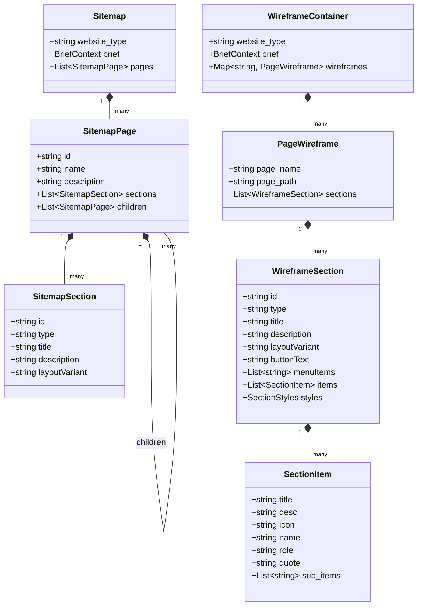

# Wireframe & Sitemap Schema Specification
**Project:** Website Design Automation System  
**Document Version:** 1.0.0  
**Phase:** Phase 1 — Architecture & Technical Foundation  
**Status:** Approved & Finalized  
**Author:** AI Engineering & Architecture Team  

---

## 1. Scope & Purpose

This document defines the formal data schemas for the **Website Design Automation System**. It establishes the contract between:
1. The **AI Model Provider** (which generates structured JSON representations of websites).
2. The **Backend Validation Engine** (which validates, sanitizes, and repairs generated structures using Pydantic).
3. The **Frontend StateManager & WireframeEditor** (which parses, mutates, and renders the visual components).

All schemas are specified using **JSON Schema (Draft 2020-12)** and companion **Python Pydantic v2 Models** ready for direct implementation in Phase 4.

---

## 2. Core Schema Hierarchy



---

## 3. Pydantic Python Models (Validation Specification)

These models represent the target Python validation structures implemented in `backend/sitemap_app/schemas/`:

```python
"""
backend/sitemap_app/schemas/wireframe.py
Pydantic v2 validation models for Sitemaps and Wireframes.
"""
from typing import List, Optional, Dict, Any, Union
from pydantic import BaseModel, Field, field_validator
import uuid


class BriefContextModel(BaseModel):
    """Contextual metadata capturing user requirements."""
    client: Optional[str] = Field(default="", description="Client or brand name")
    type: Optional[str] = Field(default="Business Website", description="Website industry/type")
    services: Optional[Union[str, List[str]]] = Field(default_factory=list)
    features: Optional[Union[str, List[str]]] = Field(default_factory=list)
    goals: Optional[str] = Field(default="")
    style: Optional[str] = Field(default="modern, clean")
    tone: Optional[str] = Field(default="professional")
    prompt_text: Optional[str] = Field(default="")


class SectionItemModel(BaseModel):
    """An individual item inside a grid, list, or card section."""
    title: Optional[str] = Field(default="", description="Item headline or card title")
    desc: Optional[str] = Field(default="", description="Descriptive copy or summary")
    icon: Optional[str] = Field(default="Check", description="Lucide icon identifier or emoji")
    # Extended fields for testimonials / quotes
    name: Optional[str] = Field(default=None, description="Author name for reviews")
    role: Optional[str] = Field(default=None, description="Author company/title")
    quote: Optional[str] = Field(default=None, description="Testimonial text")
    # Extended fields for multi-column footers
    items: Optional[List[str]] = Field(default=None, description="Sub-links list")

    @field_validator('title', mode='before')
    @classmethod
    def fallback_title(cls, v, info):
        if not v and 'name' in info.data:
            return info.data['name']
        return str(v or '').strip()


class SectionStylesModel(BaseModel):
    """Visual style overrides applied to a section element."""
    padding: Optional[int] = Field(default=None, ge=0, le=200)
    margin: Optional[int] = Field(default=None, ge=0, le=200)
    fontSize: Optional[int] = Field(default=None, ge=10, le=72)
    fontWeight: Optional[str] = Field(default=None)
    headingFont: Optional[str] = Field(default=None)
    paragraphFont: Optional[str] = Field(default=None)


class WireframeSectionModel(BaseModel):
    """Detailed layout and content model for a single section."""
    id: str = Field(default_factory=lambda: str(uuid.uuid4())[:8])
    type: str = Field(default="content", description="Canonical section type identifier")
    title: str = Field(default="Section Title")
    description: str = Field(default="")
    layoutVariant: str = Field(default="layout-default", description="CSS layout modifier")
    buttonText: Optional[str] = Field(default="", description="Call to action button copy")
    menuItems: List[str] = Field(default_factory=list, description="Navigation items for header/nav")
    items: List[SectionItemModel] = Field(default_factory=list, description="Sub-items or cards")
    styles: Optional[SectionStylesModel] = Field(default=None)

    @field_validator('type', mode='before')
    @classmethod
    def normalize_type(cls, v):
        val = str(v or 'content').strip().lower()
        # Aliasing
        aliases = {
            'nav': 'navbar',
            'header': 'navbar',
            'navigation': 'navbar',
            'main-information': 'main-info',
            'supporting-content': 'supporting-info',
            'key-features': 'features',
            'pricing-table': 'pricing',
            'testimonials': 'testimonial'
        }
        return aliases.get(val, val)


class PageWireframeModel(BaseModel):
    """Complete wireframe definition for a single page."""
    page_name: str
    page_path: str = Field(default="")
    sections: List[WireframeSectionModel] = Field(default_factory=list)


class WireframeContainerModel(BaseModel):
    """Root response envelope for multi-page wireframes."""
    website_type: str = Field(default="Website")
    brief: Optional[BriefContextModel] = Field(default_factory=BriefContextModel)
    wireframes: Dict[str, PageWireframeModel] = Field(default_factory=dict)


class SitemapSectionModel(BaseModel):
    """High-level section stub within a sitemap page."""
    id: str = Field(default_factory=lambda: str(uuid.uuid4())[:8])
    type: str = Field(default="content")
    title: str = Field(default="Section")
    description: str = Field(default="")
    layoutVariant: Optional[str] = Field(default="layout-default")


class SitemapPageModel(BaseModel):
    """Node in the sitemap page hierarchy."""
    id: str = Field(default_factory=lambda: str(uuid.uuid4())[:8])
    name: str = Field(default="New Page")
    description: str = Field(default="")
    sections: List[SitemapSectionModel] = Field(default_factory=list)
    children: List['SitemapPageModel'] = Field(default_factory=list)


class SitemapModel(BaseModel):
    """Complete sitemap specification document."""
    website_type: str = Field(default="Business Website")
    brief: Optional[BriefContextModel] = Field(default_factory=BriefContextModel)
    pages: List[SitemapPageModel] = Field(default_factory=list)
```

---

## 4. Canonical Supported Page Types Catalog

The system provides formal support and semantic defaults for **25 standard page types** across 10 major industry domains:

| Page Type ID | Canonical Name | Recommended Default Sections | Primary User Objective |
|---|---|---|---|
| `home` | Home | navbar, hero, features, main-info, testimonial, cta, footer | Welcome visitors, communicate core value proposition, drive primary conversion. |
| `about` | About Us | navbar, hero, story, values, team, stats, footer | Establish brand trust, showcase founding narrative and team credentials. |
| `services` | Services | navbar, hero, services-grid, process, pricing, cta, footer | Detail commercial offerings, deliverables, and service engagement tiers. |
| `service-detail` | Service Detail | navbar, hero, main-info, features, case-study, faq, cta, footer | Deep-dive into a specific service with technical specifications and pricing. |
| `products` | Products / Catalog | navbar, hero, filters, product-grid, promo, footer | Display catalog items with categories, filtering, and quick-add actions. |
| `product-detail` | Product Detail | navbar, product-view, specs, reviews, related-products, footer | High-conversion e-commerce product page with media, variations, and cart buttons. |
| `pricing` | Pricing | navbar, hero, pricing-table, comparison, faq, trust, footer | Transparent pricing tiers, feature comparison matrix, and billing frequency toggles. |
| `contact` | Contact | navbar, hero, contact-form, location, contact-details, footer | Direct inquiries, phone/email contact details, interactive map, and inquiry form. |
| `portfolio` | Portfolio / Work | navbar, hero, gallery, stats, testimonial, cta, footer | Visual showcase of past projects, client deliverables, and case study previews. |
| `case-study` | Case Study | navbar, hero, challenge-solution, results-stats, testimonial, footer | In-depth exploration of client problem, methodology, and measurable business outcomes. |
| `blog` | Blog / Articles | navbar, hero, featured-post, blog-grid, newsletter, footer | Editorial index with search, category filtering, and newsletter subscription banner. |
| `blog-post` | Blog Article | navbar, article-header, content, author-bio, related-posts, footer | Clean typography layout for long-form reading, social sharing, and related articles. |
| `faq` | FAQ / Help | navbar, hero, search-bar, faq-accordion, contact-cta, footer | Self-service answers to frequently asked customer questions and support channels. |
| `careers` | Careers / Jobs | navbar, hero, culture, benefits, job-listings, footer | Talent recruitment page showing team culture, employee perks, and open positions. |
| `booking-search` | Booking Search | navbar, search-form, promo, offers, trust, footer | Dedicated booking entry point with date pickers, destination inputs, and deals. |
| `booking-results` | Search Results | navbar, search-summary, filters, results-list, sorting, footer | Structured list of available flights, rooms, or rentals with live rate badges. |
| `checkout` | Checkout / Booking | navbar, order-summary, passenger-form, payment, terms, footer | High-trust checkout funnel with cart overview, billing fields, and security badges. |
| `cart` | Shopping Cart | navbar, cart-items, promo-code, order-summary, cta, footer | Review selected items, modify quantities, calculate taxes, and enter checkout. |
| `dashboard` | User Dashboard | app-header, stats-overview, activity-table, quick-actions | SaaS user portal displaying analytics widgets, account summaries, and recent activity. |
| `account-settings` | Account Settings | app-header, profile-form, security-settings, billing-history | User profile management, password updates, 2FA settings, and invoice access. |
| `legal-terms` | Terms of Service | navbar, text-content, footer | Legal document layout with clean typography, version history, and table of contents. |
| `legal-privacy` | Privacy Policy | navbar, text-content, footer | GDPR / CCPA compliant policy layout with disclosure sections and contact details. |
| `team` | Leadership & Team | navbar, hero, team-grid, values, careers-cta, footer | Executive bios, advisory board members, and team member social profiles. |
| `testimonials` | Client Reviews | navbar, hero, video-testimonials, testimonial-grid, stats, footer | Comprehensive social proof page with case quotes, ratings, and video interviews. |
| `landing-page` | Direct Response Lander | hero-minimal, features, social-proof, pricing, single-cta | Distraction-free, single-action landing page built for PPC and campaign conversions. |

---

## 5. Canonical Supported Section Types Catalog

The renderer supports **32 distinct section types** organized into 6 semantic families:

### 5.1 Navigation & Framing Sections
1. **`navbar`**: Top site navigation. Contains brand logo, menu link array, and primary call-to-action button.
2. **`footer`**: Bottom global anchor. Contains multi-column link lists (`items`), copyright line, social icons, and newsletter signup.

### 5.2 Header & Conversion Sections
3. **`hero`**: Above-the-fold introductory showcase. Includes high-impact headline, subtext, primary/secondary action buttons, and hero visual placeholder.
4. **`cta`**: High-contrast conversion strip. Focuses on an urgent headline, single value assertion, and immediate action button.
5. **`promo`**: Highlight banner for seasonal discounts, special announcements, or product launches.

### 5.3 Informational & Feature Sections
6. **`features`**: Core value proposition cards. Visualized in 2, 3, or 4-column responsive grids with icons, titles, and descriptions.
7. **`main-info`**: Primary technical or operational details. Structured as an asymmetric 2-column or list view highlighting core capabilities.
8. **`supporting-info`**: Secondary or supplementary data. Frequently used for secondary specifications, prerequisites, or contextual notes.
9. **`about`**: Narrative section detailing company history, mission statement, and founding vision.
10. **`story`**: Chronological milestone layout or narrative timeline highlighting brand evolution.
11. **`values`**: Grid of guiding organizational principles and ethics with distinctive iconography.
12. **`stats`**: Metric counters showcasing quantitative achievements (e.g., "10M+ Users", "99.99% Uptime", "150+ Countries").

### 5.4 Social Proof & Authority Sections
13. **`testimonial`**: Customer testimonials, reviews, and case quotes with avatar placeholders, names, and titles.
14. **`trust`**: Client logo clouds, security certification badges, or industry recognition awards.
15. **`team`**: Member profile cards with portrait placeholders, names, executive roles, and bios.

### 5.5 Commercial & Transactional Sections
16. **`pricing`**: Multi-tier subscription or service cards with price values, recurring intervals, and feature checklists.
17. **`services`**: Grid or alternating rows detailing specific commercial service offerings.
18. **`products`**: Product showcase cards with price badges, ratings, and action buttons.
19. **`gallery`**: Responsive image or portfolio visual grid with hover states and filter tabs.

### 5.6 Functional & Interactive Sections
20. **`contact-form`**: User input form containing name, email, phone, message inputs, and submit button.
21. **`contact-details`**: Physical office addresses, direct phone numbers, email links, and interactive map placeholders.
22. **`faq`**: Accordion-style expandable question-and-answer pairs.
23. **`search-form`**: Multi-input search widget (keywords, location, dates, dropdown filters).
24. **`filters`**: Faceted filter sidebar or top bar (categories, price sliders, sorting dropdowns).
25. **`results`**: Paginated data or search cards matching filter criteria.
26. **`fare-details`**: Detailed pricing breakdown including base fare, taxes, fees, and promotional discounts.
27. **`seat-selection`**: Interactive seat map or compartment selector.
28. **`passenger-form`**: Traveler / guest personal detail collection inputs.
29. **`addons`**: Ancillary purchase cards (extra baggage, priority boarding, travel insurance).
30. **`order-summary`**: Sticky or modular financial summary of selected services and line items.
31. **`payment`**: Secure payment method selector (credit card, digital wallet, net banking) with trust badges.
32. **`generic`**: Universal fallback component rendering arbitrary titles, text blocks, and button configurations safely.

---

## 6. Supported Layout Variants Catalog

Every section supports a `layoutVariant` property that controls the CSS layout algorithm:

### 6.1 Hero Layout Variants
- `layout-split-right`: Content on left (60%), large image/mockup on right (40%). *(Default)*
- `layout-split-left`: Image/mockup on left (40%), content on right (60%).
- `layout-centered`: Centered headline and copy with a prominent wide visual mockup underneath.
- `layout-full-bg`: Full-width visual background with high-contrast text overlay.
- `layout-asymmetric`: Dynamic 1.5fr / 1fr asymmetrical grid with overlapping graphical elements.
- `layout-minimal`: Text-focused hero with generous white space and clean typography.
- `layout-bold-text`: Ultra-large display typography with understated secondary copy.
- `layout-video-bg`: Hero container configured for looping ambient video backdrop.
- `layout-stacked`: Vertically stacked headline, subheadline, CTA group, and visual element.

### 6.2 Grid & Content Layout Variants
- `layout-grid-2`: 2-column equal-width responsive grid.
- `layout-grid-3`: 3-column equal-width responsive grid. *(Standard for features & testimonials)*
- `layout-grid-4`: 4-column compact card layout. *(Standard for stats & mini-features)*
- `layout-split`: Alternating 50/50 text-and-image horizontal rows.
- `layout-cards`: Elevated boxed cards with subtle borders and shadows.
- `layout-list`: Vertical stacked list with leading icon badges.
- `layout-multi-column`: Multi-column navigational links layout for footers.
- `layout-default`: Natural document flow fallback layout.

---

## 7. Standardized Icon Set Specification

To avoid broken images and messy unicode strings, the system standardizes on **Lucide Icon** tokens. The renderer maps these tokens to inline SVG vector paths:

```
[Security & Trust]     Shield, Lock, Award, CheckCircle, FileCheck, Key
[Performance & Tech]   Zap, Activity, Cpu, Server, Database, Cloud, Wifi
[Commerce & Finance]   CreditCard, DollarSign, ShoppingCart, ShoppingBag, Tag, Percent
[Navigation & Travel]  Plane, Compass, MapPin, Navigation, Luggage, Calendar, Clock
[Communication]        Mail, Phone, MessageSquare, Send, Bell, HelpCircle
[User & Social]        User, Users, Heart, ThumbsUp, Star, Sparkles
[Interface & Actions]  Check, ArrowRight, ArrowLeft, ChevronDown, Plus, Search, ExternalLink
```

---

## 8. Schema Validation & Auto-Repair Rules

To prevent crashes when working with non-deterministic LLMs, the backend validation pipeline executes the following mandatory repairs before returning data to the client:

1. **Section ID Normalization**: If `section.id` is missing or empty, assign `uuid.uuid4().hex[:8]`.
2. **Type Aliasing**: Convert historical and non-standard type names (`"nav"`, `"header"`, `"pricing-table"`, `"testimonials"`) into their canonical forms.
3. **Section Count Preservation**: If the AI model generated fewer sections than required by the sitemap, DO NOT discard the output. Retain all valid AI sections and append deterministic fallbacks for the missing entries.
4. **Empty Item Infilling**: If an itemized section (`features`, `pricing`, `stats`, `testimonial`) arrives with an empty `items` array, populate 3 industry-relevant placeholder items using page context.
5. **Navbar Menu Item Guarantee**: Ensure `menuItems` contains at least 3 valid links derived from the sitemap page list.
6. **Footer Infilling**: Ensure `footer` contains standard link groups (Company, Product, Resources, Legal) if none were returned.

---

## 9. Complete End-to-End JSON Payload Examples

### 9.1 Valid Sitemap Payload (`/api/generate-sitemap/`)

```json
{
  "website_type": "SaaS Platform",
  "brief": {
    "client": "PulseFlow Analytics",
    "type": "SaaS Platform",
    "services": ["Real-time Telemetry", "AI Anomaly Detection", "Custom Dashboards"],
    "goals": "Acquire B2B software engineering teams for free trial tier",
    "style": "clean, technical, high-contrast dark accents",
    "tone": "authoritative, developer-first"
  },
  "pages": [
    {
      "id": "pg-01",
      "name": "Home",
      "description": "Main landing page introducing PulseFlow's real-time telemetry engine.",
      "sections": [
        { "id": "sec-01", "type": "navbar", "title": "PulseFlow", "description": "Primary navigation bar with trial CTA" },
        { "id": "sec-02", "type": "hero", "title": "Real-time Telemetry Without Complexity", "description": "High-impact hero with terminal mockup and CTA button" },
        { "id": "sec-03", "type": "features", "title": "Engineered for Extreme Scale", "description": "Three-card grid detailing low-latency event ingestion" },
        { "id": "sec-04", "type": "main-info", "title": "Instant Anomaly Detection", "description": "Deep dive into our AI inference pipeline" },
        { "id": "sec-05", "type": "testimonial", "title": "Trusted by Platform Engineers", "description": "Social proof and testimonials from engineering leads" },
        { "id": "sec-06", "type": "cta", "title": "Start Monitoring in 60 Seconds", "description": "High-conversion free trial call to action" },
        { "id": "sec-07", "type": "footer", "title": "Footer", "description": "Multi-column links, docs, status, and legal" }
      ],
      "children": [
        {
          "id": "pg-02",
          "name": "Pricing",
          "description": "Transparent pricing tiers and enterprise licensing details.",
          "sections": [
            { "id": "sec-08", "type": "navbar", "title": "PulseFlow", "description": "Primary navigation bar" },
            { "id": "sec-09", "type": "hero", "title": "Simple, Predictable Pricing", "description": "Scale smoothly from startup to enterprise" },
            { "id": "sec-10", "type": "pricing", "title": "Subscription Plans", "description": "Three tier pricing comparison table" },
            { "id": "sec-11", "type": "faq", "title": "Frequently Asked Questions", "description": "Answers about retention, billing, and SLA" },
            { "id": "sec-12", "type": "footer", "title": "Footer", "description": "Standard footer" }
          ],
          "children": []
        }
      ]
    }
  ]
}
```

### 9.2 Valid Wireframe Payload (`/api/generate-wireframe/`)

```json
{
  "website_type": "SaaS Platform",
  "brief": {
    "client": "PulseFlow Analytics",
    "type": "SaaS Platform"
  },
  "wireframes": {
    "pg-01": {
      "page_name": "Home",
      "page_path": "Home",
      "sections": [
        {
          "id": "sec-01",
          "type": "navbar",
          "title": "PulseFlow",
          "description": "Primary navigation bar with trial CTA",
          "layoutVariant": "layout-default",
          "buttonText": "Start Free Trial",
          "menuItems": ["Features", "Integrations", "Pricing", "Documentation", "Blog"],
          "items": []
        },
        {
          "id": "sec-02",
          "type": "hero",
          "title": "Real-time Telemetry Without Complexity",
          "description": "Stream millions of events per second with sub-millisecond query latency. Built for modern cloud-native systems.",
          "layoutVariant": "layout-split-right",
          "buttonText": "Deploy in 5 Minutes",
          "menuItems": [],
          "items": []
        },
        {
          "id": "sec-03",
          "type": "features",
          "title": "Engineered for Extreme Scale",
          "description": "Zero-drop streaming ingestion paired with autonomous indexing.",
          "layoutVariant": "layout-grid-3",
          "buttonText": "Explore Architecture",
          "menuItems": [],
          "items": [
            {
              "title": "Sub-millisecond Ingest",
              "desc": "Native eBPF sensors ingest billions of metrics with less than 1% CPU overhead.",
              "icon": "Zap"
            },
            {
              "title": "Automated Anomaly Scoring",
              "desc": "Zero-configuration statistical models identify behavioral drift before outages occur.",
              "icon": "Activity"
            },
            {
              "title": "Zero-Lockin OpenTelemetry",
              "desc": "Drop-in compatibility with Prometheus, OTLP, Jaeger, and Grafana pipelines.",
              "icon": "Cloud"
            }
          ]
        },
        {
          "id": "sec-05",
          "type": "testimonial",
          "title": "Trusted by Platform Engineers",
          "description": "See why top infrastructure engineering teams rely on PulseFlow.",
          "layoutVariant": "layout-grid-3",
          "buttonText": "Read Case Studies",
          "menuItems": [],
          "items": [
            {
              "name": "Sarah Lin",
              "role": "VP Infrastructure, CloudScale",
              "quote": "PulseFlow replaced three fragmented monitoring tools and cut our incident MTTR by 64% in month one."
            },
            {
              "name": "David Ross",
              "role": "Chief Architect, FinTech Global",
              "quote": "The eBPF integration alone saved our DevOps team weeks of manual instrumentation."
            },
            {
              "name": "Elena Morales",
              "role": "SRE Lead, RetailFlow",
              "quote": "Sub-second query times over petabyte-scale telemetry. It genuinely feels like magic."
            }
          ]
        },
        {
          "id": "sec-07",
          "type": "footer",
          "title": "Footer",
          "description": "Global navigation footer",
          "layoutVariant": "layout-multi-column",
          "buttonText": "Subscribe",
          "menuItems": [],
          "items": [
            {
              "title": "Product",
              "items": ["Telemetry Hub", "Anomaly Engine", "OpenTelemetry Gateway", "Security Compliance"]
            },
            {
              "title": "Developers",
              "items": ["Documentation", "API Reference", "CLI Tooling", "GitHub SDKs"]
            },
            {
              "title": "Company",
              "items": ["About Us", "Careers", "Security & Trust", "Press Kit"]
            },
            {
              "title": "Legal",
              "items": ["Privacy Policy", "Terms of Service", "GDPR", "Cookie Settings"]
            }
          ]
        }
      ]
    }
  }
}
```

